# Перенос дизайна в Android

Визуальный эталон — исходные [design/index.html](../design/index.html) и [design/README.md](../design/README.md). Требования — [Plan.md](../Plan.md). HTML не изменён.

## Анализ и реализация

Браузерный прототип объединяет оформление, демонстрационные данные и обучение в одном файле. В Android сохранено разделение: Room и репозиторий отвечают за данные, ViewModel — за переходы занятия, Compose — за отображение. Демонстрационные словари, localStorage, рамка телефона, фиктивные системные панели и браузерные настройки в приложение не перенесены.

| Область | Реализация |
| --- | --- |
| Палитра | Бумажный фон `#F8F6F1`, поверхности `#FFFEFA`, терракотовый акцент `#C36B4F`, тёплая системная тёмная тема |
| Типографика | Системный Serif для бренда, заголовков, слов и показателей; SansSerif для управления, без загрузки шрифтов |
| Общие элементы | Отступы 22 dp, тонкие границы, локальные векторные иконки, кнопки от 48 dp, отдельное оформление опасных действий |
| Библиотека | Бренд с солнцем, вводный блок, статистика включая нули, словари с прогрессом, блок с листком, создание в шапке и нижней панели |
| Словарь | Название и статистика, блок занятия с повторением, настройки в шапке, добавление рядом со списком, импорт/экспорт, поиск, фильтры, компактные строки |
| Занятие | Прогресс, выбор формата, центральная карточка, варианты 2×2, письменное поле, разбор и транскрипция, выделение ошибки и правильного варианта |
| Результат | Символ солнца, книжный заголовок, количество карточек и возврат в словарь |
| Формы | Общий стиль, ограничения полей, подтверждения удаления и выхода, предупреждение о сбросе прогресса; пул при создании: 10, диапазон 1–100 |
| Адаптация | Контент до 720 dp, занятие до 470 dp; словари в двух колонках от 600 dp; перенос фильтров и вертикальные действия форм при крупном шрифте |
| Системное оформление | Edge-to-edge, учёт системных панелей и клавиатуры, бумажный фон запуска, терракотовая иконка приложения |

Нижние действия находятся в `Scaffold.bottomBar`: уведомления показываются над кнопками и не перехватывают нажатия на «Продолжить» и «Повторить загрузку».

Светлые основные кнопки используют тёмный текст на терракотовом фоне для контраста. Это намеренное отличие от светлого текста HTML. Различия системных шрифтов и порядка случайных вариантов ответа также ожидаемы.

Расчётный контраст текста основных кнопок и состояний верного/ошибочного ответа — от 4,85:1 в обеих темах.

## Поведение занятия

Верный выбор в изучении и повторении сразу открывает следующий вопрос либо результат. После письменного ответа, ошибки и «Пока не знаю» остаются разбор и «Продолжить». При недостатке вариантов фактический формат считается письменным.

ViewModel проверяет уникальный `questionToken` каждого показа, фактический формат ответа и отсутствие уже принятого ответа или операции. После сохранённого ответа повторяется только загрузка, если она завершилась ошибкой. Поле ввода и прокрутка сбрасываются при новом показе, в том числе того же слова.

Схема Room версии 1, формат JSON, нормализация, три верных ответа подряд, фиксированный пул и статус выученного слова при ошибке в повторении сохранены.

## Сравнительные снимки

HTML снят в Chromium при размере окна 430×880; Android — реальный рендер Compose в Robolectric с API 35 и экраном 430×880 mdpi, без системных панелей. Это снимки тестовой среды, а не проверка на физическом устройстве.

Одинаковая фикстура: словарь «На каждый день», четыре карточки `cat/кот`, `dog/собака`, `sun/солнце`, `moon/луна`, условные транскрипции `/cat/` и т. п.; пул — одна карточка. Для разбора выбран неверный `dog`, для итога закреплён `cat`. Порядок вариантов случаен. Анимация появления HTML отключена только при съёмке, исходник не менялся.

| Экран | HTML | Android, светлая тема | Android, тёмная тема |
| --- | --- | --- | --- |
| Библиотека | 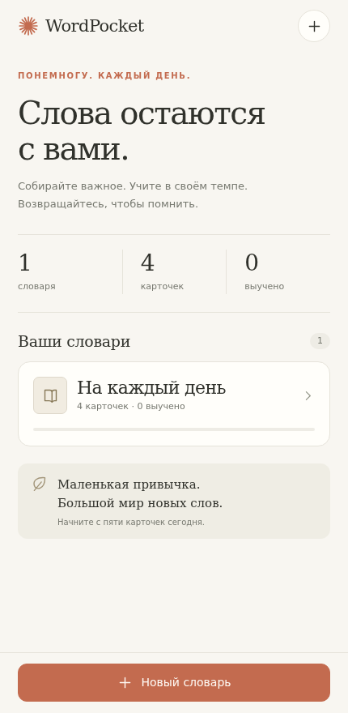 | 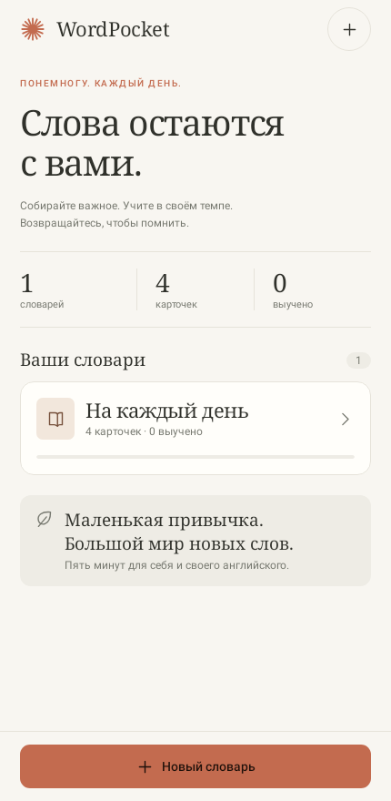 | 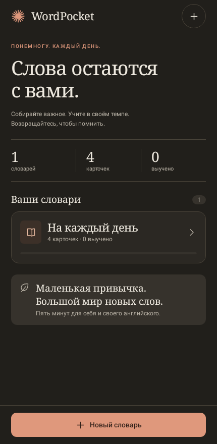 |
| Словарь | 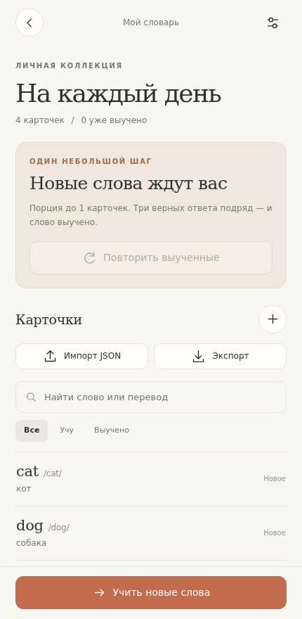 | 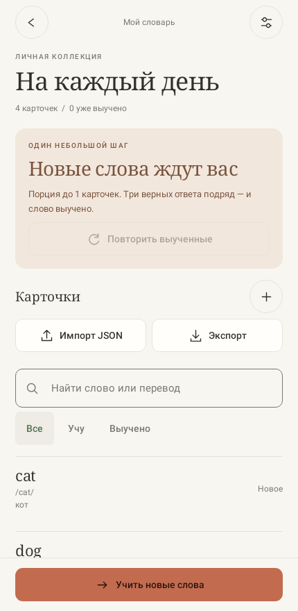 | 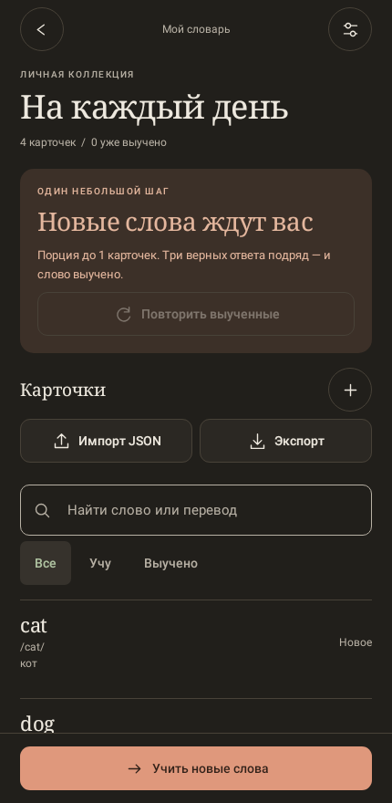 |
| Занятие | 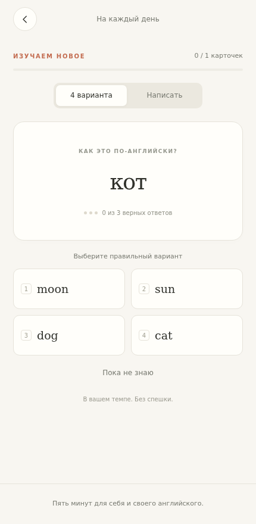 | 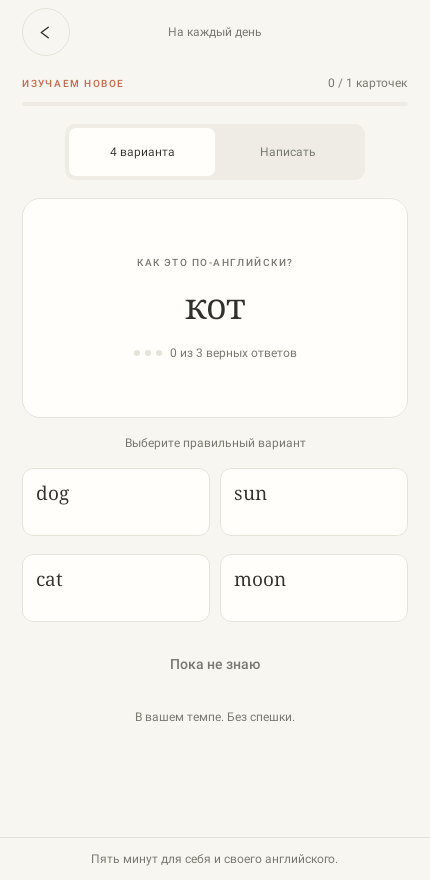 | 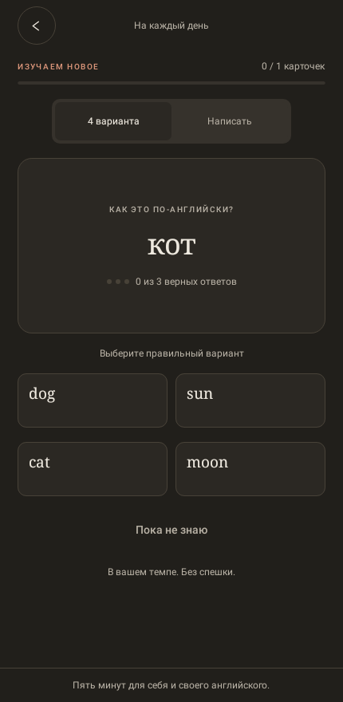 |
| Разбор | 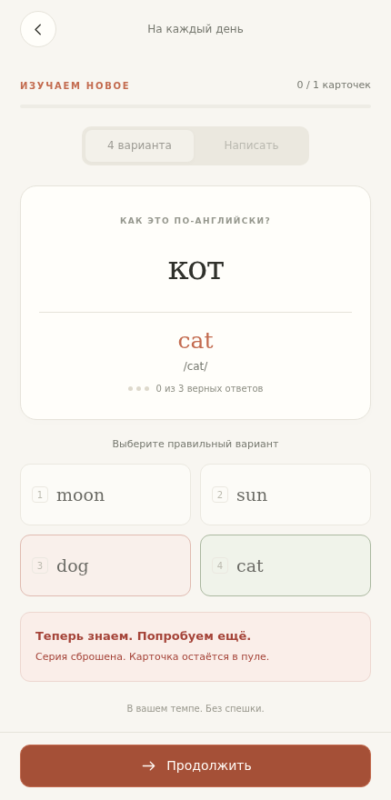 | 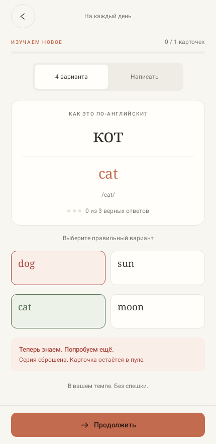 | 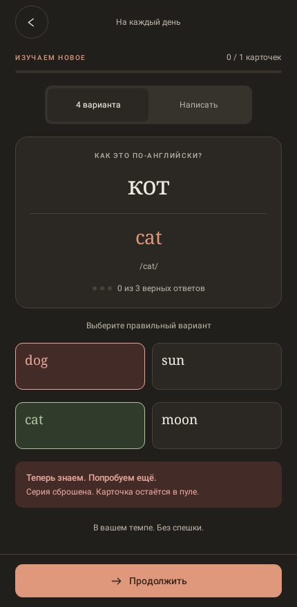 |
| Итог | 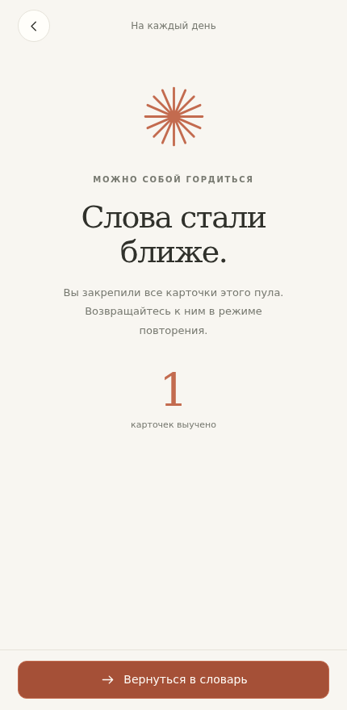 | 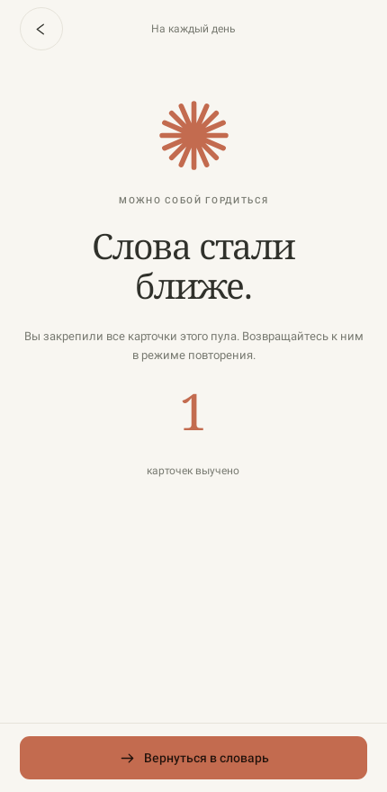 | 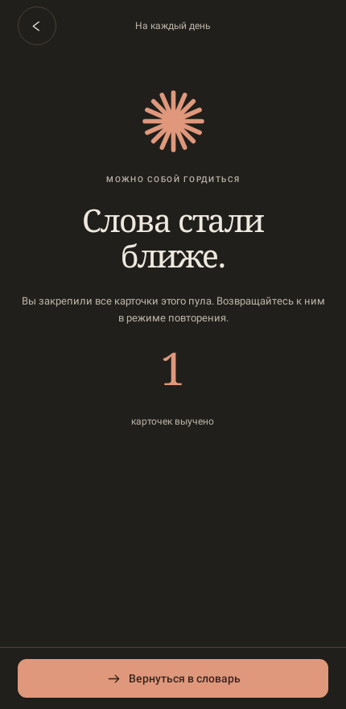 |

Снимки Android обновляются тестом `captureDesignStatesInBothThemes` в `app/build/screenshots/`. Контрольный набор для документации скопирован в `docs/screenshots/`.

Отдельный сценарий проверяет экран 320 dp со шрифтом 200%: [библиотека](screenshots/library-small-large-font.png), [словарь](screenshots/dictionary-small-large-font.png), [занятие](screenshots/training-small-large-font.png). Граница перехода сетки с одной на две колонки проверяется на JVM при 599 и 600 dp.

## Оставшаяся ручная приёмка

На Android-устройстве нужно проверить клавиатуру, поворот и системный жест назад; файловые провайдеры импорта/экспорта; сохранение после завершения процесса; авиарежим; планшет и обновление поверх прежней установки без удаления данных. Полный список — в [ACCEPTANCE.md](ACCEPTANCE.md), фактические результаты автоматических проверок — в [BUILD.md](BUILD.md).
